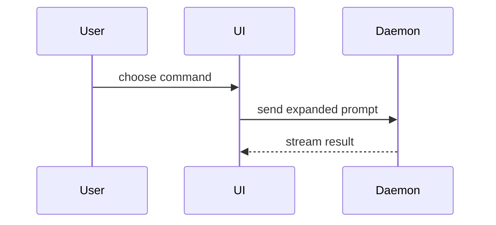

Use this template for writing the PR body:

```markdown
## Overview

<one paragraph, high level>

## Summary

<diagram, diff-sketch, or tree>

- **Inputs:** <where they come from; linked by code (import) or only by data (files)>
- **Consumers:** <follow-up issues or specs that read the outputs>
- **Extend here:** <where follow-up work on the same spec should change things>

## Files

**New**

- `<path>`: <responsibility in one sentence>. <What it does: inputs, outputs, validations, main functions or structures.>

**Modified**

- `<path>`: <what was added, changed, or removed>. <What stayed the same.>

**Outside Git**

- `<path>`: <what it is, why it was kept, and where it goes before the worktree is removed>.

## Choices left open

1. **<choice>:** <what was decided, why, and the effect of choosing otherwise>.

## Evidence

- **Before:** <screenshot/output/failing test run>
  **After:** <screenshot/output/passing test run>

## Out of scope and not verified

- **<item>:** <what was left out or was not tested or measured, and why>.

## Merge Danger

**Door:** <one-way or two-way>

<optional: description>

**Blast Radius:** <one-word description>

<optional: potential ramifications of merge>
```

## Sections

Skip all preambles and keep prose brief. Use the user's domain language from `GLOSSARY.md`. Write for someone who knows the project but has not read the diff, in the user's language.

The headings, their order, and the item formats are fixed. Write "None." (in the user's language) under an empty section or group instead of removing its heading. Size the content to the PR: for a docs-only or trivial change, one line per section is enough.

Write from the diff of the PR's current head (`git diff --name-status <base>...HEAD` and each file's diff), not from memory of the session. When the branch changes after the body was written, rewrite the body from the new head.

### Overview

One plain-prose paragraph, high level, in the user's language. Say what the PR adds or changes, the question or problem it serves and why, how it works in broad strokes, and where it fits in the larger plan (parent spec, follow-up issues). No code, no lists, no test details. Assume the reader knows the project, not the diff.

### Summary

Pick the smallest view that makes the key point clear.

- Show logic or an algorithm as pseudocode:

```text
on(save)
  if content is unchanged
    return cached result
  write new content
  return fresh result
```

- Show runtime control flow as a call tree:

```text
submitForm
  createSession
    persistPrompt
    launchAgent
  navigateToSession
```

- Show UI structure as a component tree, including state and module boundaries that matter:

```text
<SessionPage> (apps/example/src/routes/session.tsx)
  useSessionEvents()
  <SessionToolbar>
    <RunSkillButton> (packages/ui)
```

- Show file responsibility or a broad refactor as a shallow file tree:

```text
src/
├── commands/       # parses user actions
├── sessions/       # owns session state
└── transport/      # sends API requests
```

- Show component interaction, control flow, or data flow with Mermaid:



- Use `diff` when the point is what changes and the surrounding shape already exists. Match the diff shape to the topic.

For a component change:

```diff
 <SessionPage>
   useSessionEvents()
   <SessionToolbar>
+    <RunSkillButton />
   <SessionTimeline>
+    <SkillResultCard />
```

For a file-layout change:

```diff
 src/
 ├── commands/
+│   └── show-me.ts       # expands the slash command
 ├── sessions/
-└── transport.ts
+└── transport/
+    ├── client.ts
+    └── stream.ts
```

For a call-tree or call-stack change:

```diff
 submitForm
   createSession
     persistPrompt
+    expandSkillMention
     launchAgent
-  navigateToSession
+  navigateToSession
+    subscribeToEvents
```

For a state or control-flow change:

```diff
 on(save)
-  write content
+  if content is unchanged
+    return cached result
+  write new content
+  invalidate cache
```

- Show the whole block when most of it is new, when omitted context would hide ownership or order, or when the user needs a copyable target shape:

```ts
function expandSkill(command: string): string {
  const skillName = command.slice(1);
  return `use the ${skillName} skill`;
}
```

#### Guidance

Place each visual next to the short text it supports. Keep only the calls, files, props, states, and boundaries needed to answer the user's current question or the options to resolve the current discussion point.

You may use one of these, you may use several, it is unlikely you will use all of them. Use your judgement and don't overwhelm the user.

#### How the files connect

When the PR touches more than one file, one of the visuals shows how they connect: the dependencies between the PR's files (who calls whom, in which direction) and their link to the rest of the project. Below the visuals, the **Inputs**, **Consumers**, and **Extend here** lines say where the inputs come from and whether the link is by code or only by data, who will read the outputs, and where follow-up work on the same spec should change things. Don't repeat this view elsewhere in the body.

### Files

One item per file, grouped as **New**, **Modified**, and **Outside Git**. For a new file, give its responsibility and what it does: inputs, outputs, validations, and its main functions or structures. For an existing file, say what was added, changed, or removed, and what stayed the same; mark a deleted file as removed. Use sub-items for a file with several changes. **Outside Git** lists artifacts the work produced but does not commit (data, outputs, smoke runs): where they are and why they were kept. No pasted code.

### Choices left open

Every decision made without an explicit instruction from the issue, the spec, or the user: what was decided, why, and the effect of choosing otherwise. These are what the reader most needs to see in time to disagree.

### Evidence

Concrete evidence that the change works. Show a before and after.

Screenshots are S-tier - when the environment is set up for it and the change is visual.

Execution-based evidence is A-tier. Test results, console output. Show the exact test that now fails and passes, using pseudocode.

List only checks that were actually run, at the commit they ran on.

### Out of scope and not verified

What was left for other issues, and what was not tested or measured, with the reason. Keep it separate from Evidence so that nothing unverified reads as verified.

### Merge Danger

Describe whether it's a one-way or two-way door. You can walk back through two-way doors, but not one-way doors. A PR that is cheap to roll back is lower risk. Changes that involve destructive actions or hard-to-reverse decisions are one-way doors.

The blast radius is the potential impact or scope of the changes introduced by this PR. Consider all possibilities. Examples are layout shift, breakages for consumers, mobile responsiveness, etc.

## Check before publishing

Compare the body with `git diff --name-status <base>...HEAD`. Every added file is under **New**, every modified file under **Modified**, and every deleted file under **Modified**, marked as removed. All sections are present in the template's order. Complete anything missing before you create or edit the PR.
